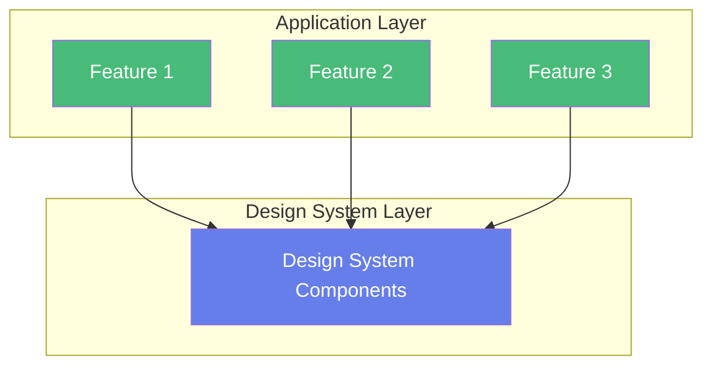
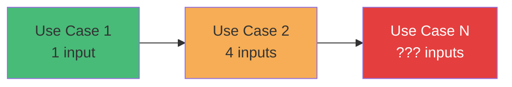
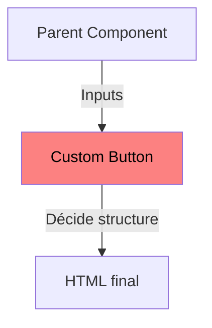
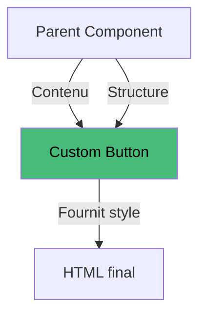

---
# try also 'default' to start simple
theme: seriph
# random image from a curated Unsplash collection by Anthony
# like them? see https://unsplash.com/collections/94734566/slidev
background: https://images.unsplash.com/photo-1549716679-95380658d5cd?w=500&auto=format&fit=crop&q=60&ixlib=rb-4.1.0&ixid=M3wxMjA3fDB8MHxzZWFyY2h8OTh8fGRlc2lnbnxlbnwwfHwwfHx8Mg%3D%3D
# some information about your slides (markdown enabled)
title: (Re)Découvrir la Projection de Contenu
# https://sli.dev/features/drawing
drawings:
  persist: false
transition: slide-left
# enable MDC Syntax: https://sli.dev/features/mdc
mdc: true
# duration of the presentation
duration: 35min
---

<style>
h3 {
  padding: 1rem;
}
</style>

# (Re)Découvrir la Projection de Contenu

L'art de concevoir des composants UI customisés, réutilisables et flexibles

<div class="pt-12">
  <span @click="$slidev.nav.next" class="px-2 py-1 rounded cursor-pointer" hover="bg-white bg-opacity-10">
    Commencer <carbon:arrow-right class="inline"/>
  </span>
</div>

<!--
Fonctionnalité d'Angular sous-exploitée mais extrêmement puissante
étude de cas métier réaliste, 
transformer notre approche de conception de composants.
-->

---
transition: fade-out
---

# Au programme

<v-click>

1. **Contexte & Fondations**
2. **Évolution progressive**
3. **Les limites de l'approche input**
4. **La solution : Content Projection**
5. **Comparaison & Analyse**
6. **Patterns avancés**

</v-click>

<div class="abs-br m-6 text-sm">
  <carbon:information class="inline"/> ~30 minutes
</div>

<!--
1. On commence par poser le contexte : équipes Angular avec un Design System partagé.
2. On implémente des use cases progressifs avec l'approche classique par inputs.
3. On identifie les limites de cette approche (explosion d'inputs, rigidité).
4. On découvre la projection de contenu comme solution.
5. On compare les deux approches pour savoir quand utiliser chaque pattern.
6. On explore des patterns avancés : multi-slot et ng-template avec context.
-->

---
layout: center
class: text-center
---

# Partie 1

## Contexte & Fondations

---
background: /img/balazs-ketyi-_x335IZXxfc-unsplash.jpg
---

# Le contexte métier

## La situation

Equipes Angular cross-produits avec un Design System


<v-click>

**Besoin identifié :**

- Composants UI customisés
- Réutilisables dans plusieurs features/domaines métier
- Maintenables à long terme
- Évolutifs selon les besoins métier

</v-click>


<!--
Différents domaines métier (finance, RH, logistique, etc.).
Chaque équipe avait ses propres composants UI, -> expérience utilisateur fragmentée et incohérente.

L'entreprise a décidé d'homogénéiser l'interface utilisateur en créant un Design System centralisé avec des composants UI customisés et identiques pour tous les domaines.

Défi : Comment concevoir ces composants partagés pour qu'ils :
- Répondent aux besoins spécifiques de chaque domaine métier
- Restent maintenables malgré les demandes divergentes
- Évitent de devenir des monolithes rigides avec des dizaines d'inputs
- Permettent l'innovation sans casser l'existant

Un Design System n'est pas qu'une bibliothèque de composants : c'est un contrat entre designers et développeurs. L'API de nos composants doit être pensée avec soin.

Avantages détaillés :
- **Cohérence visuelle** :
  - Même look & feel partout dans l'application
  - Respect automatique de la charte graphique
  - Expérience utilisateur unifiée entre domaines métier
- **Productivité** :
  - Réutilisation au lieu de duplication de code
  - Time to market réduit pour les nouvelles features
  - Focus des équipes sur la logique métier, pas sur l'UI
- **Maintenance** :
  - Un changement dans le DS = impacts multiples automatiques
  - Corrections de bugs propagées partout
  - Évolutions UI centralisées
- **Onboarding** :
  - Nouveaux devs opérationnels plus vite
  - Patterns et bonnes pratiques déjà établis
  - Moins de décisions à prendre sur l'UI
- **Centralisation des tests** :
  - Tests unitaires des composants une seule fois
  - Garantie de qualité pour tous les consumers
  - Réduction de la dette technique

Contraintes détaillées :
- **API stable** :
  - Versioning sémantique et stratégie de migration
  - Rétro-compatibilité entre versions
  - Breaking changes documentés et communiqués
- **Flexibilité** :
  - Anticiper les besoins sans sur-engineer
  - Permettre la customisation sans tout exposer en inputs
- **Documentation** :
  - Examples interactifs (Storybook, Stackblitz)
  - Migration guides pour les breaking changes
-->

---

# Architecture de notre Design System



<v-click>

<div class="mt-8 p-4 bg-blue-50 rounded">

**Notre objectif :** Créer un composant `CustomButton` réutilisable dans nos 3 features

</div>

</v-click>

<!--
Structure classique : une couche de composants partagés utilisée par plusieurs features. Le challenge : maintenir cette couche stable malgré des besoins divergents.
-->

---
layout: center
class: text-center
---

# Partie 2

## Évolution Progressive
### Les Use Cases

---

# Use Case 1 : Simple Button

<div class="grid grid-cols-2 gap-4">

<div class="flex flex-col">

<div>

#### Demande métier


</div>

<div v-click="4" class="mt-4 p-4 bg-green-50 rounded text-sm text-center">

<p><b>API minimaliste</b></p>
<p><b>Facile à comprendre</b></p>

</div>

</div>

<div class="flex flex-col gap-4">
<div v-click="1">

#### Code TypeScript

```typescript
  label = input.required<string>();
  clicked = output<void>();
```

</div>

<div v-click="2">

#### Solution : Template

```html
    <button class="button__container"
      (click)="clicked.emit()">
      <span class="button__label">
        {{ label() }}
      </span>
    </button>
```

</div>
<div v-click="3">

#### Utilisation / Consommateur

```html
  <app-custom-button 
    label="Click on me" 
    (clicked)="onClick()"
  />
```
</div>
</div>
</div>
<!-- "On a besoin d'un bouton avec juste du texte, dans un style card avec gradient"
Premier use case : très simple, une API avec un seul input obligatoire. Tout va bien, notre composant fait exactement ce qu'on lui demande. Mais la vie d'un produit n'est jamais statique...
-->

---

# Use Case 2 : Ajout d'icônes

<div class="grid grid-cols-2 gap-4">

<div>

#### Nouvelle demande métier


</div>

<div class="flex flex-col gap-4">
<div v-click>

#### Solution : ajout d'inputs

```typescript
  label = input.required<string>();
  icon = input<string | undefined>();   // 🆕
  endIcon = input<string | undefined>();// 🆕
  inline = input<boolean, boolean | string>(false,
    {transform: booleanAttribute}
  );   // 🆕
  clicked = output<void>();

```

</div>

<div v-click="2">

#### Utilisation / Consommateur

```html
  <app-custom-button
    label="Click on me"
    icon="refresh"
    inline
    (clicked)="onClick()"
  />
```
</div>
</div>

<div v-click="3" class="bg-yellow-50 flex flex-row flex-nowrap gap-24 mx-auto col-span-2 p-4 rounded text-sm text-center">

<p><b>3 nouveaux inputs</b></p>
<p><b>Logique conditionnelle complexe</b></p>
<p><b>2 modes de layout différents</b></p>

</div>

</div>

<!--
Première évolution : on ajoute des icônes. L'API commence à grossir.
Template complexité augmente.
-->

---

# Use Case 2 : Complexité du template

<div class="text-sm">

```typescript {all|2-2,5-5,13-13,20-20|6-8,14-18|10-12}
    <button type="button" class="card-button" 
      [class.card-button--inline]="inline()"
      [disabled]="disabled()" (click)="onClick()">

      @if (inline()) {
        @if (icon()) {
          <span class="card-button__icon material-symbols-outlined">{{icon()}}</span>
        }
        <span class="card-button__label">{{label()}}</span>
        @if (endIcon()) {
          <span class="card-button__icon material-symbols-outlined">{{endIcon()}}</span>
        }
      } @else {
        @if (icon()) {
          <div class="card-button__icon-container">
            <span class="card-button__icon material-symbols-outlined">{{icon()}}</span>
          </div>
        }
        <span class="card-button__label">{{label()}}</span>
      }
    </button>
```

</div>

<!--
3 blocs conditionnels juste pour gérer l'affichage des icônes. 
Et ce n'est que le deuxième use case !
🚨 **Premier signal d'alerte** : 
La logique conditionnelle se complexifie. Chaque nouveau besoin va ajouter des conditions supplémentaires.
-->


---
layout: center
class: text-center
---

# Partie 3

## Les Limites de l'approche de l'input

---

# Évolution de notre API

<div class="text-center mb-8">



</div>


<v-clicks>

# Les 4 problèmes majeurs
</v-clicks>
<div class="grid grid-cols-2 gap-4">
<v-clicks>

#### 1. Explosion du nombre d'inputs

#### 2. Impossible d'anticiper tous les cas

#### 3. Maintenance cauchemardesque

#### 4. Complexité des tests

</v-clicks>
</div>

<!--

### 1. 💥 Explosion des inputs (Prop Drilling)

- Chaque nouveau besoin = nouveau @Input
- API qui devient incompréhensible
- Difficulté à savoir quels inputs sont requis

### 2. 🔒 Rigidité de la structure HTML

- Le composant décide de **toute** la structure interne
- Impossible d'ajouter du contenu non prévu
- On ne peut pas prévoir tous les besoins futurs
- Exemple : ajouter un badge, un tooltip, un sous-titre ?

### 3. 🔄 Maintenance cauchemardesque

- Chaque modification impacte tous les consumers
- Tests à refaire à chaque évolution
- Risque de régression élevé

### 4. 🧪 Complexité des tests

- Tester toutes les combinaisons de inputs
- Tests exponentiels : 6 inputs booléens = 64 combinaisons !
- Mock de plus en plus complexes


Problèmes sont interconnectés. 
Le vrai souci : on essaie de tout contrôler depuis le composant.
Partage de responsabilité

-->

---


# Le vrai problème : Inversion de responsabilité

<div class="grid grid-cols-2 gap-8">

<div>

### ❌ Approche actuelle




</div>

<div v-click>

### ✅ Ce qu'on voudrait



</div>

</div>


<!--
C'est le cœur du problème : on a inversé la responsabilité. Le composant devrait être un conteneur générique.

Le **composant enfant** décide de tout :
- Structure HTML
- Ordre des éléments
- Contenu exact
- Style des enfants

Le **parent** décide du contenu :
- Quelle structure HTML
- Quels éléments afficher
- Dans quel ordre
- Quel contenu

💡 **Il faut inverser le contrôle** : le parent doit pouvoir injecter du contenu  dans le composant

-->


---
layout: center
class: text-center
---

# Partie 4

## La Solution : Content Projection

---

# Content Projection

<div class="grid grid-cols-2 gap-8">

<div>

### Principe

<div v-click class="projection-demo relative h-24 my-4">
  <div class="container-box absolute right-4 top-2 w-40 h-16 rounded-lg flex items-center justify-center text-xs bg-blue-500 text-green-400" >
    &lt;ng-content /&gt;
  </div>
  <div class="content-item absolute top-4 py-2 rounded shadow-lg animate-project border-2 border-dashed border-green-400">
    🤍 Click here
  </div>
</div>

<style>
@keyframes projectContent {
  0% { left: 0; color: black; border-color: rgb(74 222 128); box-shadow: 0 10px 15px -3px rgb(0 0 0 / 0.1); }
  100% { left: calc(100% - 9.5rem); color: white; border-color: transparent; box-shadow: none; }
}
:not(.slidev-vclick-hidden).slidev-vclick-target .animate-project {
  animation: projectContent 5s ease-in-out 3s forwards;
}
:not(.slidev-vclick-hidden).slidev-vclick-target .container-box {
  transition: all 0.3s;
  animation: hideText 4.5s ease-in-out 3s forwards;
}
@keyframes hideText {
  100% { color: transparent; }
}
</style>

<div v-click="4">


- Disponible depuis **Angular 2** (2016)
- Inspiré des Web Components `<slot>`

</div>

</div>

<div>

### Syntaxe de base

```typescript {none|5|all}
@Component({
  selector: 'custom-card',
  template: `
    <div class="card-shadow">
      <ng-content />
    </div>
  `
})
export class CustomCard {/* ... */}
```

</div>

</div>

<!--
Content Projection : un concept simple mais puissant. Au lieu de passer du contenu via des inputs, on l'injecte directement dans le template du composant.
Comme pour le HTML
-->

---

# Button avec projection

<div class="grid grid-cols-2 gap-4">

<div>

```typescript {6|all}
@Component({
  selector: 'app-custom-button',
  template: `
    <button (click)="clicked.emit()">
      <div class="button-content">
        <ng-content />
      </div>
    </button>
  `,
  style: `.button-content { ... }`
})
export class CustomButton {
  clicked = output<void>();
}
```

<div class="mt-4 p-4 bg-green-50 rounded text-sm flex flex-col">

##### API minimaliste
##### Template ultra simple
##### Aucune logique conditionnelle

</div>

</div>

<div>

```typescript {none|1-4|6-12|14-24}
// Cas 1 : Texte simple
<app-custom-button (clicked)="onSave()">
  Enregistrer
</app-custom-button>

// Cas 2 : Avec icône Material
<app-custom-button (clicked)="onSave()">
  <div class="card-button inline">
    <mat-icon fontIcon="save" />
    Enregistrer
  </div>
</app-custom-button>

// Cas 3 : Structure complexe
<app-custom-button (clicked)="onSave()">
  <div class="card-button inline">
    <app-icon name="save" />
    <app-label 
      tooltip="Permet de sauvegarder votre travail">
      Enregistrer
    </app-label>
    <app-badge>New</app-badge>
  </div>
</app-custom-button>
```

</div>

</div>

<!--
Regardez la différence : le composant CustomButton est maintenant ultra simple. Toute la complexité est déportée vers le parent, qui décide de la structure exacte.
-->

---
layout: center
class: text-center
---

# Partie 5

## Comparaison & Analyse

---

# Approche input vs Content Projection

<div class="overflow-auto text-sm">

| Critère | input Approach | Content Projection |
|---------|----------------|-------------------|
| **Complexité API** | 🔴 Croît exponentiellement | 🟢 Stable et minimaliste |
| **Flexibilité** | 🔴 Limitée aux inputs définies | 🟢 Presque illimitée |
| **Structure HTML** | 🔴 Figée dans le composant | 🟢 Décidée par le parent |
| **Maintenance** | 🔴 Chaque besoin = modification | 🟢 Composant stable |
| **Tests** | 🔴 Combinaisons exponentielles | 🟢 Tests simples et isolés |
| **Courbe d'apprentissage** | 🟢 Intuitive au début | 🟡 Concept à maîtriser |
| **Lisibilité** | 🔴 Template complexe avec conditions | 🟢 Template ultra simple |
| **Évolutivité** | 🔴 Modifications breaking | 🟢 Non-breaking |
| **Composition** | 🔴 Difficile | 🟢 Naturelle |

</div>

<!--
Le tableau parle de lui-même. La projection de contenu gagne sur presque tous les critères, surtout ceux liés à la maintenabilité à long terme.

### 1. 🎯 API minimaliste et stable

- Un seul composant pour tous les cas
- Pas de breaking changes à chaque évolution
- Documentation simple et claire

### 2. 🔓 Flexibilité maximale

- Le parent contrôle 100% du contenu
- Support natif de cas non prévus
- Pas besoin de modifier le composant pour de nouveaux besoins

### 3. 🧩 Composition naturelle

- Assemblage de petits composants réutilisables
- Pattern familier (comme HTML natif)
- Découplage des responsabilités

### 4. ✅ Testabilité améliorée

- Tests unitaires simples : un seul chemin de code
- Pas de combinaisons exponentielles à tester
- Mocks simplifiés

### 5. 🚀 Performance

- Pas de props à tracker pour la détection de changement
- `display: contents` pour éviter les wrappers inutiles
- Rendering optimal

### 6. 🎨 Séparation des responsabilités

- Composant = styles et comportement (click, disabled)
- Parent = structure et contenu
- Clear separation of concerns

### 7. 📚 Maintenabilité long terme

- Composant qui ne change pas = pas de régression
- Évolution incrémentale sans breaking changes
- Code auto-documenté par l'usage

Sept avantages majeurs qui font de la projection le pattern de choix pour les composants UI génériques. C'est un investissement qui paie sur le long terme.

-->

---

# Quand utiliser chaque approche ?

<div class="grid grid-cols-2 gap-4">

<div>

### Préférer input quand :

<div class="space-y-2">

<div class="p-2 bg-blue-50 rounded">

**Cas d'usage très spécifique**

Composant avec logique métier précise qui ne variera pas

</div>

<div class="p-2 bg-blue-50 rounded">

**API simple et stable**

2-3 inputs maximum, cas d'usage bien définis et stable

</div>

</div>

</div>

<div>

### Préférer Projection quand :

<div class="space-y-2">

<div class="p-2 bg-green-50 rounded">

**Composants UI génériques**

Design system, bibliothèque de composants réutilisables

</div>

<div class="p-2 bg-green-50 rounded">

**Formattage divers**

Plusieurs transformations possibles, utilisation pipe (DatePipe, CurrencyPipe, ...)

</div>

</div>

</div>

</div>

<!--
Les deux approches ont leur place. La clé : identifier si votre composant est générique (projection) ou spécifique (inputs). Pour un Design System, la projection est presque toujours le bon choix.

Structure du contenu variable selon le contexte
Besoin d'imbriquer plusieurs composants

-->

---
layout: center
class: text-center
---

# Partie 6

## Patterns avancés

---

# Pattern hybride : le meilleur des deux mondes

<div class="grid grid-cols-2 gap-4">
<div>
<div v-click>

### Composant inputs
```typescript
  variant = input<ButtonVariant>('primary');
  size = input<ButtonSize>('medium');
  color = input<ButtonColor>('default');

  buttonClasses = computed(() =>
    `btn btn--${this.variant()} btn--${this.size()}`
  );
```

</div>

<div v-click="3">

### Utilisation

```html
<app-custom-button variant="secondary" size="small">
  <app-icon name="edit" />
  Modifier
</app-custom-button>
```
</div>

</div>
<div  v-click="2">

### Template
```html
<button [class]="buttonClasses()">
  <ng-content />
</button>
```

### CSS
```scss
.btn { display: inline-flex; ... }
.btn--primary { background: ... }
.btn--secondary { background: ... }
.btn--small { padding: ... }
.btn--medium { padding: ... }
```
</div>
</div>
<!--
Combiner input pour la configuration et projection pour le contenu
Le pattern hybride : utiliser les inputs pour la configuration visuelle simple, et la projection pour le contenu. C'est souvent le sweet spot pour les composants complexes.
-->

---
layout: default
---

# Pattern avancé : Multi-slot Projection

<div class="grid grid-cols-2 gap-6">

<div>

### Composant

```typescript
@Component({
  template: `
    <div class="card">
      <div class="header">
        <ng-content select="[slot='header']" />
      </div>
      <div class="body">
        <ng-content />
      </div>
      <div class="footer">
        <ng-content select="[slot='footer']" />
      </div>
    </div>
  `
})
```

</div>

<div>

### Utilisation

```html
<app-card>
  <h2 slot="header">Titre</h2>
  <p>Contenu principal</p>
  <button slot="footer">Action</button>
</app-card>
```

<div class="mt-6 p-4 bg-blue-50 rounded text-sm">

- Plusieurs zones de projection nommées
- Le slot par défaut (`<ng-content />`) capture le reste
- Permet des layouts complexes (header/body/footer)

</div>

</div>

</div>

<!--
Multi-slot projection : permet de définir plusieurs zones où le contenu peut être injecté. Très utile pour les layouts de type card, modal, panel.
-->

---
layout: default
---

# Pattern avancé : ng-template + Context

<div class="grid grid-cols-2 gap-6">

<div>

### Composant

```typescript
@Component({
  template: `
    <div class="list">
      @for (item of items(); track item.id) {
        <ng-container
          *ngTemplateOutlet="
            itemTemplate();
            context: { $implicit: item }
          "
        />
      }
    </div>
  `
})
export class List<T> {
  items = input.required<T[]>();
  itemTemplate = contentChild
    .required(TemplateRef);
}
```

</div>

<div>

### Utilisation

```html
<app-list [items]="users">
  <ng-template let-user>
    <app-user-card [user]="user" />
  </ng-template>
</app-list>
```

<div class="mt-6 p-4 bg-purple-50 rounded text-sm">

📖 **Pour aller plus loin :**

- `contentChild` / `contentChildren` pour interagir avec le contenu projeté
- Projection conditionnelle avec `*ngTemplateOutlet`

</div>

</div>

</div>

<!--
ng-template avec context : permet de passer des données du composant vers le template projeté. Pattern très puissant pour les listes, tables, et composants itératifs.
-->

---
layout: end
class: text-center
---

# Merci !

Questions ?

<div class="mt-8 text-sm opacity-75">

📚 Documentation Angular : [angular.dev/guide/components/content-projection](https://angular.dev/guide/components/content-projection)

🎬 Vidéo recommandée : [Content Projection in Angular](https://youtu.be/N8S2mPuGkgg?si=_bQtahnt7idxT4kV)

</div>

<div class="abs-br m-6 flex gap-2">
  <a href="https://github.com/sbruno/ng-content" target="_blank" alt="GitHub" title="Voir le code"
    class="text-xl slidev-icon-btn opacity-50 !border-none !hover:text-white">
    <carbon:logo-github />
  </a>
</div>

<!--
Merci de votre attention ! N'hésitez pas à poser vos questions, à partager vos cas d'usage, et surtout : testez la projection de contenu dans vos prochains composants !
-->
